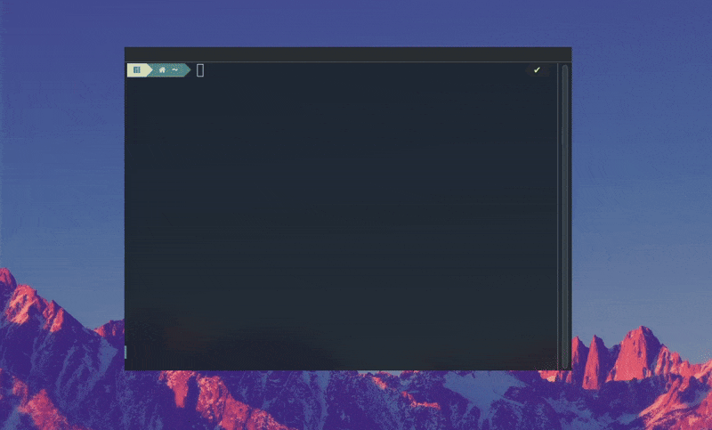

# Conclusion

In conclusion, Keyla-TTT is the result of a structured and planned project using DDD methodology.
Its development executed in CI/CD through GitHub Actions workflows for format control and code correctness has allowed to have always correct and clean code, as well as tested in every part (thanks to the test jobs).
The same workflows have also been used for automating the release of new versions, which happens automatically through semantic-release, with the creation of specific artifacts and the publication of documentation on GitHub Pages.
The meta repo has allowed to integrate the two projects (API and CLI) into a single one, enabling a unified release on dockerhub usable in any environment.

## Demo of the app

