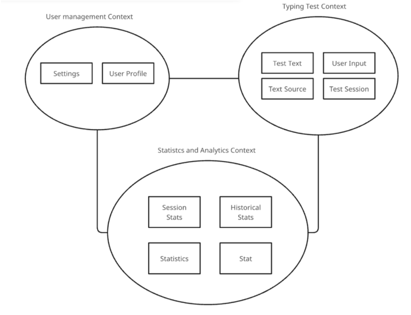
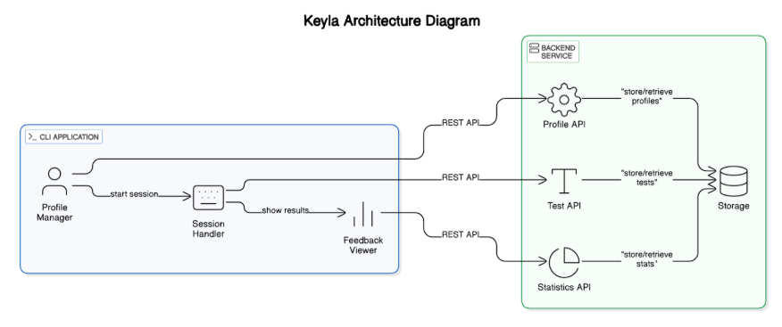
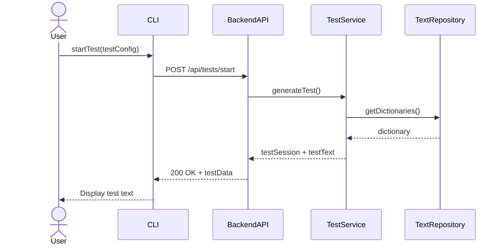

# Design

## Problem

There are many people who want to improve their **typing skills**, 
whether for professional or personal reasons. 
Typing tests help users identify their strengths and weaknesses, 
track their progress over time, and set goals for improvement.
The actual tools are only online services, but there are many users who want to use a local tool.

## Solution

A **local tool** that allows users to take typing tests, track their progress, 
and analyze their performance over time.

## Domain

The project is about the **Digital Writing**, 
this means the ability to write text using a computer keyboard with a certain speed and accuracy.

## Bounded Contexts
The Digital Writing domain has been divided into three main contexts 
to manage complexity and ensure clarity of responsibilities:

- **User Management**: allow users to create and manage their profiles
- **Typing Test**: allow users to take typing tests and record their performance. 
Here the user can choose the configuration of the test
- **Statistics & Analytics**: allow users to view their performance statistics and
the improvement/results over time

## Ubiquitous Language

| Domain Term            | Technical Concept | Bounded Context                         | Description                                                              |
|:-----------------------|:------------------|-----------------------------------------|:-------------------------------------------------------------------------|
| User Profile           | `Profile`         | User Management                         | Account identified by a unique name to access the tool                   |
| Profile ID             | `ProfileId`       | User Management                         | Unique identifier of a profile                                           |
| Configs                | `Configs`         | User Management                         | Configurations of the system                                             |
| Test Session           | `Test Session`    | Typing test                             | Typing test instance started by a user                                   |
| Test Text              | `TestText`        | Typing test                             | Words, symbols, and numbers to be typed during the test                  |
| User Input             | `UserInput`       | Typing test                             | Text actually typed by the user, with a timestamp for each character     |
| Test Sources           | `TestSource`      | Typing test                             | Dictionary from which the test draws for word selection                  |
| Modifiers              | `Modifiers`       | Typing test                             | Settings that modify the test (Capital letter, camel case, reverse, ...) |
| Merger                 | `Merger`          | Typing test                             | Combines multiple dictionaries into a single one                         | 
| WPM (Words per minute) | `WPM`             | Typing test / Statistics and Analytics  | Metric: number of correctly typed words                                  |
| Accuracy               | `Accuracy`        | Typing test / Statistics and Analytics  | Percentage of correct characters out of the total typed                  |
| Raw Accuracy           | `RawAccuracy`     | Typing test / Statistics and Analytics  | Percentage of correct characters out of the total characters in the test |
| Errors                 | `Errors`          | Typing test / Statistics and Analytics  | When the user types the wrong character                                  |
| Statistics             | `Stats`           | Statistics and Analytics                | Performance data of each test                                            |
| Analytics              | `Analytics`       | Statistics and Analytics                | Statistics over time                                                     |

## Domain Model

### User Management

**Purpose**: Manages user profiles and system configurations

**Core Components**:
- **Aggregate Root**: `PROFILE`
  - Manages user identity and profile data
  - Controls access to user-specific settings and preferences
- **Value Object**: `SETTINGS`
  - Encapsulates user preferences (theme, language, default test parameters)
  - Immutable configuration data

**Infrastructure**:
- **Repository**: `ProfileRepository` - Handles profile data persistence
- **Factory**: `ProfileFactory` - Creates new profile instances
- **Domain Events**: `ProfileCreated`, `ProfileUpdated`, `ProfileDeleted`

**Responsibilities**:
- User profile creation and management
- System configuration management
- User preference management

### Typing Test

**Purpose**: Manages typing test execution and text generation

**Core Components**:
- **Aggregate Root**: `TEST SESSION`
  - Controls test lifecycle and state transitions
  - Manages test text and user input coordination
- **Value Objects**:
  - `TEST TEXT`: Content to be typed during the test
  - `USER INPUT`: User keystrokes
  - `TEXT SOURCE`: Dictionaries for text generation in different languages

**Infrastructure**:
- **Repositories**:
  - `TextSourceRepo` - Manages dictionaries and text sources
  - `TypingTestRepo` - Stores test session metadata
  - `TestInfoRepo` - Persists test execution data
- **Factory**: `TestSessionFactory` - Creates new test sessions
- **Service**: `TestTextGenerator` - Generates appropriate test content
- **Domain Events**: `TestStart`, `TestCompleted`, `TestInterrupt`

**Responsibilities**:
- Test session lifecycle management
- Text generation and selection
- User input capture and validation
- Test configuration management
### Statistics & Analytics

**Purpose**: Processes and analyzes typing performance data

**Core Components**:
- **Aggregate Root**: `STATISTICS`
  - Manages both session-level and historical performance data
  - Controls access to statistical calculations and analytics
- **Value Objects**:
  - `ANALYTICS`: Aggregated performance over time
  - `STATS`: Core metrics (WPM, Accuracy, RawAccuracy)

**Infrastructure**:
- **Repository**: `StatisticsRepo` - Persists session and historical statistics
- **Services**:
  - `StatisticsCalculator` - Handle immediate test metrics
  - `AnalyticsCalculator` - Generates trend analysis and insights

**Responsibilities**:
- Performance metric calculation
- Historical data aggregation
- Trend analysis and insights
- Progress tracking over time
## Technical Architecture

Keyla follows a client-server architecture with a clear separation between the frontend (CLI) and 
backend (API server). 
This design allows for distributed deployment, scalability, 
and the ability to support multiple client types in the future.

### System Components

**Frontend**
- **Purpose**: Provides the user interface for interacting with typing tests
- **Responsibilities**:
  - User input capture
  - Compute test metrics (WPM, Accuracy, Errors)
  - Real-time test display and feedback
  - Test session management (start, stop, restart)
  - Results presentation and visualization

**Backend**
- **Purpose**: Manages all business logic, data persistence, and core functionality
- **Responsibilities**:
  - User profile management
  - Test text generation and dictionary management
  - Statistics and analytics 
  - Data persistence and historical tracking

## Information Flow

The system follows a client-server communication pattern 
where the CLI frontend interacts with the backend through API calls. 
This section illustrates the typical user journey and the underlying API interactions.

### Test Starting Flow

The diagram above illustrates the process of starting a typing test:

1. **User Request**: The user initiates a test by providing difficulty and duration parameters through the CLI
2. **API Call**: The CLI sends a POST request to `/api/tests/start` with the test parameters
3. **Test Generation**: The backend TestService generates a new test session
4. **Text Selection**: The TestService retrieves appropriate text from the TextRepository
5. **Response**: The backend returns the test session data and text content to the CLI
6. **Display**: The CLI presents the test text to the user, ready for typing

This simplified flow demonstrates the core interaction between the CLI frontend and backend API, 
showing how user requests are processed and test content is delivered for the typing exercise.

