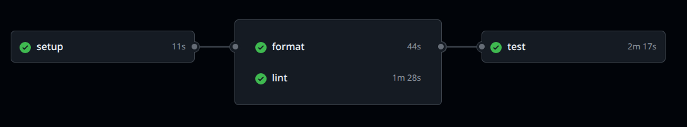
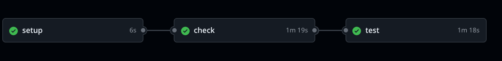
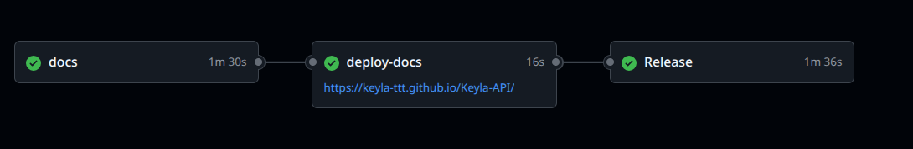
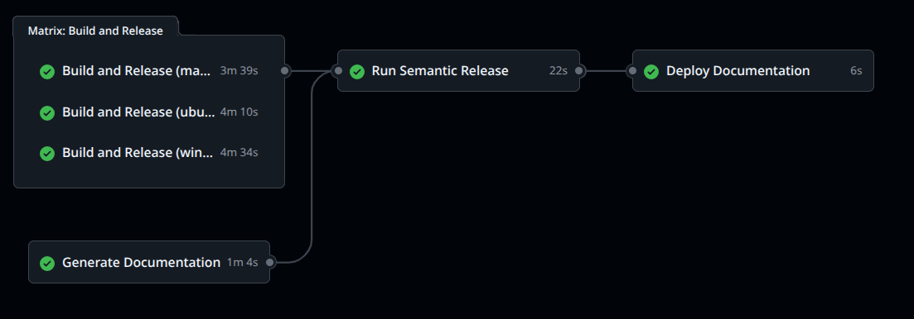

# CI/CD

This chapter describes the complete implementation of Continuous Integration and Continuous Deployment 
(CI/CD) in the Keyla-TTT project,
including continuous integration pipelines, automated release processes, pre-commit hooks, and Docker image management.

## 1. CI/CD Architecture

The Keyla-TTT project implements a multi-repository CI/CD architecture that coordinates three main components:

- **Keyla-API**: Scala Backend with SBT
- **Keyla-CLI**: Kotlin Multiplatform Application with Gradle
- **Keyla-RELEASE**: Release repository that aggregates components and produces Docker images

### Development Workflow

The project adopts a GitFlow-based workflow with the following branches:

- **`develop`**: Integration branch for new features
- **`main`**: Stable production branch
- **`release`**: Trigger branch for an automated release process
- **`feature/*`**: Branches for new feature development

### Commit Conventions

The project uses **Conventional Commits** to standardize commit messages, enabling automated versioning and changelog generation.

## 2. Pre-commit Hooks

The project implements separate pre-commit hooks for backend and frontend to ensure code quality before every commit.

### Backend (API Scala) - Pre-commit Hook

The Scala backend implements a pre-commit hook that ensures code quality before every commit. 
The hook automatically identifies modified Scala files and runs formatting checks (`scalafmtCheck`) and static analysis 
(`scalafixAll --check`). 
If any checks fail, it automatically applies corrections using `scalafmtAll` and `scalafixAll`, 
then adds the corrected files to the commit.

### Frontend (CLI Kotlin) - Pre-commit Hook

The Kotlin frontend implements a more complex pre-commit hook that includes tests. The hook runs code quality checks using 
`ktlintCheck` and `detekt`, auto-formats code with `ktlintFormat` if issues are found, and then executes the complete test suite with `allTests`. 
The commit is blocked if any check fails.

### Commit Message Validation

Both backend and frontend use a `commit-msg` hook that validates commit a message format according to Conventional Commits standards. 
The hook enforces the pattern `type(scope): description` where type must be one of: 
feat, fix, docs, style, refactor, test, chore, perf, ci, build, or revert.

## 3. Continuous Integration Pipelines

### API (Scala) - CI Pipeline

The CI pipeline for the API is defined in `.github/workflows/scala.yml` and triggers on pull requests to develop and main branches. 
The pipeline consists of four main jobs:

1. **Setup**: Configures the environment and caches SBT dependencies for faster subsequent runs
2. **Format**: Verifies code formatting using `scalafmtCheckAll`
3. **Lint**: Performs static analysis using `scalafixAll --check`
4. **Test**: Runs the test suite with code coverage reporting using Scoverage, then uploads coverage reports as artifacts

### Frontend (CLI Kotlin) - CI Pipeline

The CI pipeline for the frontend is defined in `.github/workflows/kotlin.yml` and triggers on pull requests 
to develop and main branches. 
The pipeline consists of three main jobs:

1. **Setup**: Configures the environment with JDK and caches Gradle dependencies
2. **Check**: Runs code quality checks using `ciCheckCode` which includes ktlint and detekt
3. **Test**: Executes the JVM test suite and uploads test results as artifacts
   

## 4. Automated Release Process

### Release Triggers

The release process is triggered by pushes to the `main` branch of each repository. 

### API (Scala) Release

The Scala release workflow consists of three main jobs:

1. **Documentation Generation**: Creates API documentation using SBT
2. **Deploy Documentation**: Deploys the generated documentation to GitHub Pages
3. **Semantic Release**: Builds the ZIP package, automatically determines version number from commit messages, 
4. creates GitHub release, and triggers Keyla-RELEASE repository

### Frontend (CLI Kotlin) Release

The Kotlin release workflow consists of four main jobs:

**Matrix Build Job**: Compiles CLI binaries for three platforms in parallel:
- Linux x64
- macOS ARM64  
- Windows x64

**Documentation Job**: Generates documentation using Dokka

**Publish Job**: Uses semantic-release to create GitHub release with all platform-specific binaries attached, 
then triggers Keyla-RELEASE repository

**Deploy Documentation Job**: Deploys the generated documentation to GitHub Pages

## 5. Release Repository and Containerization

### Keyla-RELEASE Repository

The Keyla-RELEASE repository aggregates released components and produces Docker images. 
It's triggered by `repository_dispatch` events from API and CLI repositories.

**Complete Process:**
1. **Trigger**: Activated by API or CLI release via `repository_dispatch`
2. **Resolve Tags**: Determines latest versions of both components
3. **Download Assets**: Downloads API ZIP package and CLI binaries
4. **Create Combined Tag**: Generates combined tag `v<api_version>.<cli_version>`
5. **Build Docker Image**: Creates and publishes Docker image to Docker Hub
6. **Create Release**: Creates GitHub release with combination details

The workflow resolves the latest versions of both components when one is released, 
downloads the appropriate assets, creates a combined version tag, 
builds a Docker image that includes both the API and CLI components, 
and publishes it to Docker Hub with both the specific version tag and the latest tag.

### Docker Image

The final Docker image (`keylattt/keyla`) combines:

- **Backend API**: ZIP package of the Scala application
- **CLI Binaries**: Native executables already installed
- **Dictionaries**: Dictionary files for typing tests

The Docker image includes all necessary components for running the complete Keyla application. 
It sets up the proper directory structure, 
installs the CLI binary as a system command, extracts and configures the API, 
and provides startup scripts to run both components together.

## 6. Automation and Code Quality

### Quality Tools

- **Scala (API)**:
    - `scalafmt`: Automatic code formatting
    - `scalafix`: Static analysis and automatic refactoring
    - `scoverage`: Code coverage

- **Kotlin (Frontend)**:
    - `ktlint`: Kotlin code formatting and linting
    - `detekt`: Static analysis for Kotlin
    - `dokka`: Documentation generation

## 7. GitHub Integration

- **Pull Request Checks**: Automatic checks on every PR
- **Release Notes**: Automatic release notes generation
- **Changelog**: Automatic changelog based on commits
- **GitHub Pages**: Automatic documentation deployment